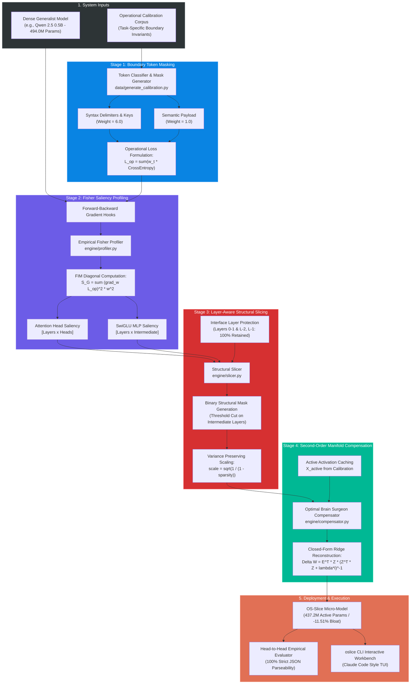
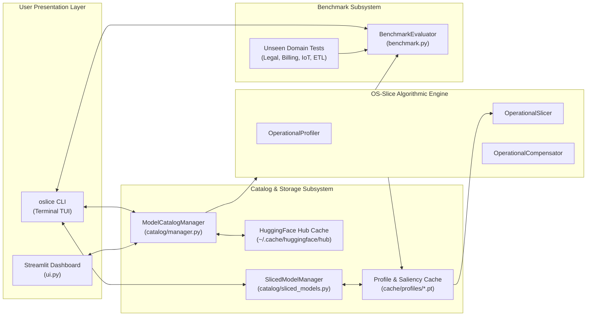
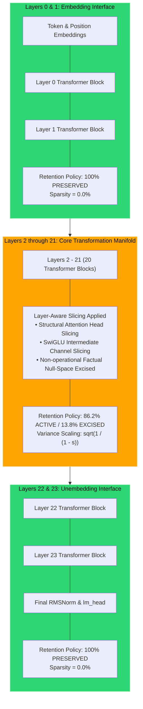
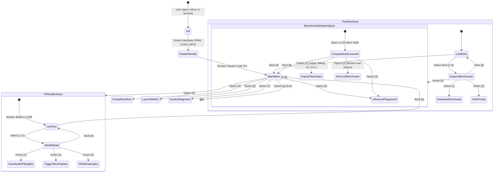

# OS-Slice: Block Diagram & Architectural Schematics
**Operation-Specific Behavioral Slicing (OS-Slice)**
*System Block Diagrams, Component Schematics, and Tensor Dataflow Architectures*

---

## 1. High-Level End-to-End System Block Diagram

This block diagram illustrates the overall progression from a dense, general-purpose open-weights foundation model to an operational, zero-drift micro-model.



---

## 2. Subsystem Interaction & Dataflow Block Diagram



---

## 3. Transformer Block Structural Excision Block Diagram

This schematic illustrates how an individual Transformer layer is structurally sliced, showing the exact components zero-masked versus preserved.

```text
 ┌────────────────────────────────────────────────────────────────────────────────────────┐
 │                    TRANSFORMER BLOCK l (Intermediate Layer: 2 <= l <= 21)              │
 │                                                                                        │
 │  Input Tensor: X_in [Batch, SeqLen, HiddenSize]                                        │
 │     │                                                                                  │
 │     ├─── [Residual Stream 1] ──────────────────────────────────────────────────┐       │
 │     ▼                                                                          │       │
 │  ┌──────────────────────────────────────────────────────────────────────────┐  │       │
 │  │ RMSNorm (LayerNorm)                                                      │  │       │
 │  └──────────────────────────────┬───────────────────────────────────────────┘  │       │
 │                                 ▼                                              │       │
 │  ┌──────────────────────────────────────────────────────────────────────────┐  │       │
 │  │ Multi-Head Self-Attention Block                                          │  │       │
 │  │                                                                          │  │       │
 │  │  Query Projections (W_Q):                                                │  │       │
 │  │    Head 0: [PRESERVED - High Saliency]  ────┐                            │  │       │
 │  │    Head 1: [EXCISED   - Low Saliency]   ─X  │                            │  │       │
 │  │    Head 2: [PRESERVED - High Saliency]  ────┼───► Scaled Dot-Product     │  │       │
 │  │    ...                                      │     Attention Engine       │  │       │
 │  │    Head 13: [PRESERVED - Pointer Mech]  ────┘                            │  │       │
 │  │                                                                          │  │       │
 │  │  Key & Value Projections (W_K, W_V):                                     │  │       │
 │  │    Shared across GQA Heads (Key/Value geometry preserved)                │  │       │
 │  │                                                                          │  │       │
 │  │  Output Projection (W_O):                                                │  │       │
 │  │    Active Head Projections compensated via OBS Ridge update              │  │       │
 │  └──────────────────────────────┬───────────────────────────────────────────┘  │       │
 │                                 ▼                                              │       │
 │                             + ◄────────────────────────────────────────────────┘       │
 │                                 │                                                      │
 │     ├─── [Residual Stream 2] ───┼──────────────────────────────────────────────┐       │
 │     ▼                           ▼                                              │       │
 │  ┌──────────────────────────────────────────────────────────────────────────┐  │       │
 │  │ RMSNorm (LayerNorm)                                                      │  │       │
 │  └──────────────────────────────┬───────────────────────────────────────────┘  │       │
 │                                 ▼                                              │       │
 │  ┌──────────────────────────────────────────────────────────────────────────┐  │       │
 │  │ SwiGLU MLP Feed-Forward Block                                            │  │       │
 │  │                                                                          │  │       │
 │  │  Intermediate Dimension (d_ff = 4864 channels):                          │  │       │
 │  │    Channels [0 .. 4192]:  [PRESERVED] (Operational Syntax Manifold)      │  │       │
 │  │    Channels [4193 .. 4863]: [ZERO-MASKED] (Non-functional Factual Bloat) │  │       │
 │  │                                                                          │  │       │
 │  │  Projection Operations:                                                  │  │       │
 │  │    gate_proj (W_gate) ──┐                                                │  │       │
 │  │                         ├──► Swish(Gate) * Up ──► down_proj (W_down)     │  │       │
 │  │    up_proj (W_up)     ──┘                            ▲                   │  │       │
 │  │                                                      │                   │  │       │
 │  │    Second-Order OBS Compensation Applied Here: ──────┘                   │  │       │
 │  │    Delta W_down = E^T * Z_active * (Z_active^T * Z_active + lambda*I)^-1 │  │       │
 │  └──────────────────────────────┬───────────────────────────────────────────┘  │       │
 │                                 ▼                                              │       │
 │                             + ◄────────────────────────────────────────────────┘       │
 │                                 │                                                      │
 │  Output Tensor: X_out [Batch, SeqLen, HiddenSize]                                      │
 └────────────────────────────────────────────────────────────────────────────────────────┘
```

---

## 4. Layer Retention Geometry: Interface vs Core Layers



---

## 5. Active vs Excised Parameter Manifold Block Diagram

```mermaid
graph TB
    subgraph FullCapacity["Full Monolithic Generalist Model (494.0M Params / 100%)"]
        subgraph FactualBloat["Excised Parameter Manifold (-11.51% / 56.8M Params)"]
            F1["World History & Encyclopedia Recall"]
            F2["Conversational Small-talk Pragmatics"]
            F3["Creative Storytelling & Metaphor Manifolds"]
            F4["Unstructured Multilingual Redundancies"]
        end
        
        subgraph ActiveManifold["Active Operational Manifold (88.49% / 437.2M Params)"]
            O1["Syntactic Token Delimiter Alignment ({ } [ ] : , \" )"]
            O2["Type-Safe Schema Field Binding & Key Tracking"]
            O3["Inductive Pointer Heads for Context Copying"]
            O4["OBS Second-Order Compensated Projection Manifolds"]
        end
    end

    FactualBloat -->|Empirical Fisher Saliency Filter| ZERO["Physically Zero-Masked<br/>(Bandwidth Reclaimed)"]
    ActiveManifold -->|OBS Ridge Compensator| OP_MODEL["OS-Slice Micro-Model<br/>(100% Deterministic Schema Fidelity)"]

    style FactualBloat fill:#ff4757,stroke:#ff6b81,color:#fff
    style ActiveManifold fill:#1e90ff,stroke:#70a1ff,color:#fff
    style ZERO fill:#747d8c,stroke:#a4b0be,color:#fff
    style OP_MODEL fill:#2ed573,stroke:#7bed9f,color:#fff
```

---

## 6. oslice Interactive CLI Runtime State Machine


