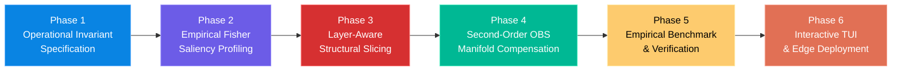
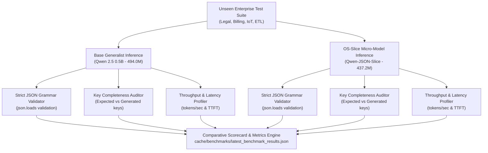

# OS-Slice: End-to-End Operational Workflow Specification
**Operation-Specific Behavioral Slicing (OS-Slice)**
*Complete Operational Lifecycle: From Invariant Specification to Production Micro-Model Deployment*

---

## 1. High-Level Workflow Overview

The OS-Slice workflow spans six distinct phases that transform a generalist, monolithic foundation model into an operation-specific, zero-drift micro-model:



---

## 2. Phase-by-Phase Execution Workflows

### Phase 1: Operational Invariant Specification & Calibration Generation
**Objective:** Define the syntactic and behavioral constraints of the target operation and generate boundary-conditioned calibration tokens.

```
  Step 1.1: Define Operational Target Primitive
     │      (e.g., Strict Structured JSON Extraction, Text-to-SQL AST, API Tool Dispatch)
     ▼
  Step 1.2: Generate Diverse In-Domain Scenarios (`data/generate_calibration.py`)
     │      (Legal Contracts, Cloud Billing, IoT Sensor Telemetry, Database ETL)
     ▼
  Step 1.3: Apply Operational Boundary Token Masking
     │      • Syntactic Delimiters (`{`, `}`, `[`, `]`, `"`, `:`, `,`) ──► Weight lambda_struct = 6.0
     │      • Schema Keys (Field Identifiers)                      ──► Weight lambda_struct = 6.0
     │      • Semantic Payload Values (Strings, Numbers, Bools)     ──► Weight lambda_payload = 1.0
     ▼
  Step 1.4: Compile Batched Calibration Tensors
            `input_ids`, `attention_mask`, `labels`, `operational_weights`
```

---

### Phase 2: Empirical Fisher Saliency Profiling
**Objective:** Profile parameter curvature and identify which attention heads and SwiGLU MLP channels directly mediate the operational loss.

```
  Step 2.1: Initialize Profiler (`engine/profiler.py`)
     │      Load pre-trained model into eval mode with grad tracking enabled.
     ▼
  Step 2.2: Attach Forward-Backward PyTorch Hooks
     │      Capture intermediate activations X_in and gradient tensors grad_w L_op.
     ▼
  Step 2.3: Execute Weighted Forward-Backward Passes
     │      Compute Operational Loss: L_op = sum(w_t * CrossEntropy(y_t, hat_y_t))
     │      Execute: L_op.backward()
     ▼
  Step 2.4: Calculate Structural Fisher Saliency
     │      • Head Saliency: S(G_h^(l)) = sum_{w in G_h} (grad_w L_op)^2 * w^2
     │      • MLP Channel Saliency: S(G_m^(l)) = sum_{w in G_m} (grad_w L_op)^2 * w^2
     ▼
  Step 2.5: Persist Saliency Profile Cache
            Save to `cache/profiles/operational_fisher_profile.pt`
```

---

### Phase 3: Layer-Aware Structural Parameter Slicing
**Objective:** Physically zero-mask non-operational parameters while preserving outer interface layers and applying variance scaling.

```
  Step 3.1: Load Saliency Profile & Architectural Config (`engine/slicer.py`)
     ▼
  Step 3.2: Apply Layer Retention Policy
     │      • Interface Layers (0-1 and L-2, L-1): 100% PRESERVED (Sparsity = 0.0%)
     │      • Intermediate Layers (2 to L-3): Slicing applied based on target ratio.
     ▼
  Step 3.3: Compute Quantile Thresholds
     │      Identify bottom k-th percentile saliency scores for heads and MLP channels.
     ▼
  Step 3.4: Generate Binary Hardware Masks
     │      • Head Mask: M_head in {0, 1}^[L x H]
     │      • MLP Mask:  M_mlp in {0, 1}^[L x d_ff]
     ▼
  Step 3.5: Execute Channel Zero-Masking & Scaling
            Apply M_head and M_mlp directly to projection weights.
            Scale active weights: W_active <- W_active * sqrt(1 / (1 - s))
```

---

### Phase 4: Second-Order OBS Manifold Compensation
**Objective:** Realign surviving parameter manifolds using closed-form ridge regression to eliminate syntax drift in under 1 second.

```
  Step 4.1: Collect Active Calibration Activations (`engine/compensator.py`)
     │      Pass calibration batches through the sliced model to capture X_active.
     ▼
  Step 4.2: Compute Output Discrepancy Residuals
     │      Residual: R = W_orig * X_orig - W_active * X_active
     ▼
  Step 4.3: Solve Closed-Form Ridge Inversion
     │      Delta W_active = R * X_active^T * (X_active * X_active^T + lambda * I)^(-1)
     │      (Where lambda = 1e-3 regularizer prevents ill-conditioned matrix inversion)
     ▼
  Step 4.4: Update Active Projection Weights
     │      W_active <- W_active + Delta W_active
     ▼
  Step 4.5: Instantiate Compact `OSSliceModel` Micro-Model
            Active parameters: 437.2M (-11.51% memory load, 0% gradient drift).
```

---

### Phase 5: Empirical Benchmarking & Invariant Verification
**Objective:** Perform a rigorous head-to-head empirical audit against unseen real-world enterprise evaluation prompts.



---

### Phase 6: User Interaction & CLI Workflow (`oslice`)
**Objective:** Provide an intuitive, responsive terminal workbench for managing models, downloading weights, inspecting audits, and running inference.

```
  1. Terminal Entry:
     User runs `oslice` in terminal ──► Powershell/CMD executes `bin/oslice.cmd`
                                  ──► Loads `oslice_cli.py` with Rich Console
     
  2. Main Menu Selection:
     ├── [1] Pre-Sliced Models Hub
     │       └── Browse operational micro-models ──► Inspect active parameters ──► Activate
     │
     ├── [2] Hugging Face Model Library
     │       └── Browse 11 models (360M to 120B) ──► Audit RAM/VRAM ──► Download snapshot
     │
     ├── [3] Empirical Benchmarks & Deep Analysis
     │       ├── View Base vs Sliced Scorecard (Active Params, Parseability, Throughput)
     │       ├── Inspect side-by-side domain outputs (Legal, Billing, IoT, ETL)
     │       └── Execute live benchmark run in real time
     │
     ├── [4] Create New OS-Slice
     │       └── Wizard: Pick Base Model ──► Select Primitive ──► Slicing Ratio ──► Run
     │
     ├── [5] Operational Inference Playground
     │       └── Select or enter custom prompt ──► Generate type-safe JSON with syntax colors
     │
     ├── [6] Launch Web Dashboard
     │       └── Spawns Streamlit graphical interface on http://localhost:8501
     │
     └── [7] System Diagnosis & Hardware Audit
             └── Inspect CUDA, Apple MPS, physical RAM, and cache directories
```

---

## 3. Developer & Researcher Quick Reference Guide

### Running Workflow Tasks Manually from Terminal

| Task | PowerShell / Bash Command |
| :--- | :--- |
| **Launch Full Interactive CLI** | `oslice` |
| **One-Line Automatic Installer** | `irm https://raw.githubusercontent.com/KIRTAN0902/OS-Slice/main/install.ps1 \| iex` |
| **Run Empirical Benchmark Directly** | `python os_slice_prototype/benchmark.py` |
| **Launch Browser Web Dashboard** | `streamlit run ui.py` |
| **Generate Fresh Calibration Profile**| `python os_slice_prototype/data/generate_calibration.py` |
| **Inspect System Cache & Hardware** | `oslice` -> Option `[7]` |
| **Download Any Hugging Face Model** | `oslice` -> Option `[2]` -> Pick model -> Option `[1]` |
